<p align="center">
  
</p>

<p align="center">
  <a href="#-feature-showcase"><b>Features</b></a> &nbsp;·&nbsp;
  <a href="#-product-preview"><b>Preview</b></a> &nbsp;·&nbsp;
  <a href="#-system-architecture"><b>Architecture</b></a> &nbsp;·&nbsp;
  <a href="#-installation"><b>Install</b></a> &nbsp;·&nbsp;
  <a href="#-security-and-data-integrity"><b>Security</b></a> &nbsp;·&nbsp;
  <a href="docs/api-reference.md"><b>API</b></a> &nbsp;·&nbsp;
  <a href="#-documentation"><b>Docs</b></a>
</p>

<p align="center">
  
  
  
  
  
  
</p>

> [!IMPORTANT]
> **Status — read before using real data.** Every workflow is implemented and covered by tests, but the client's payroll workbook (formulas, rounding), completed sample months and payslip format **have not been received**. Until they are reconciled, every calculated amount, payslip and report is labelled **PROVISIONAL**. Not yet deployed. See [Roadmap](#-roadmap) and [docs/known-gaps.md](docs/known-gaps.md).


## ◆ About the project

**NexziByte Payroll Management** is a web application that replaces a monthly Excel payroll workbook for a trading and distribution business of about 150 people.

| Focus | Summary |
|---|---|
| **The problem** | Payroll lives in one spreadsheet, maintained by one experienced person. It works — but it is hard to audit, hard to hand over, and every check depends on that person's memory. |
| **The solution** | A structured, permission-controlled workflow: an employee master, versioned salary structures, an Excel-like monthly input grid, server-side calculation, review and approval, **immutable** finalised months, payslips and reports — plus alerts, reconciliation and a knowledge centre so someone else can take over. |
| **Design principles** | All calculations run on the server · money is `DECIMAL`, never floating point · finalised history can never change · nothing is invented: formulas come from the client workbook only. |


## ◆ Feature showcase

<p align="center">
  
</p>

<details>
<summary><b>Feature details</b></summary>

| Area | What is implemented |
|---|---|
| **Employees** | List, search, filter and sort; create and edit; deactivate or exit (never hard-deleted); CSV/XLSX import with column mapping, row-level validation and a downloadable error report; export |
| **Salary** | Components with basis *fixed*, *percentage of another component*, *monthly input* or *approved formula*; per-employee **versioned** structures with effective dates and change history |
| **Monthly payroll** | One run per month; Excel-like grid (arrow/Enter navigation, paste a block from Excel); invalid cells keep what was typed; deterministic, decimal-safe calculation; exceptions panel |
| **Approval** | Draft → Calculated → Under review → Approved (optional step) → Finalised; separate-approver policy available; re-open needs an Administrator and a reason |
| **Outputs** | Payslip preview, stored individual PDFs, bulk print-ready PDF; monthly summary, earnings, deductions, net payable and employee salary statement (screen, PDF, XLSX) |
| **Payroll alerts** *(change request A)* | Configurable rules against earlier finalised months — net and component changes, unusual / first-time / repeated monthly amounts, possible duplicate employees — each with the numbers behind it, a review outcome and an append-only history |
| **Reconciliation** *(change request B)* | Compare any two calculated months by employee and component; absolute and % differences; explain as *expected*, *discrepancy* or *resolved*; PDF/XLSX export |
| **Knowledge centre** *(change request F)* | Versioned procedures, component notes, business rules and error fixes with owners and review dates; undocumented items flagged; a monthly checklist per run |
| **Access** | Sign-in with lockout, self-service sign-up with an emailed 6-digit code, roles with configurable permissions (Administrator, Payroll User, optional Viewer), append-only audit log |

Change requests A, B and F are not in the original specification and await approval through the change-request process — see [docs/change-requests.md](docs/change-requests.md).

</details>


## ◆ Product preview

Real screenshots of the application running locally against a **separate demo database with fictional employees and amounts**. No real person's data appears.

<p align="center">
  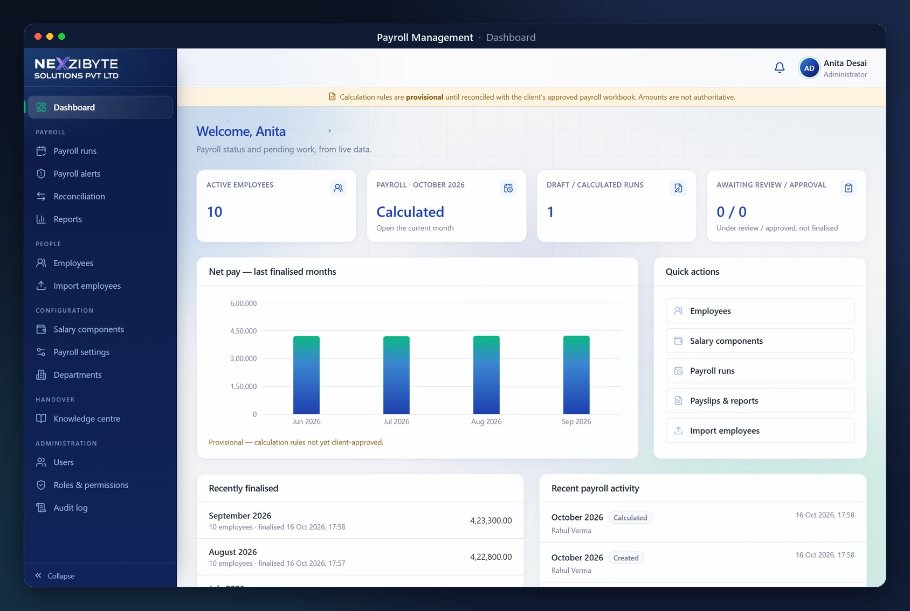
</p>

<table>
  <tr>
    <td width="50%">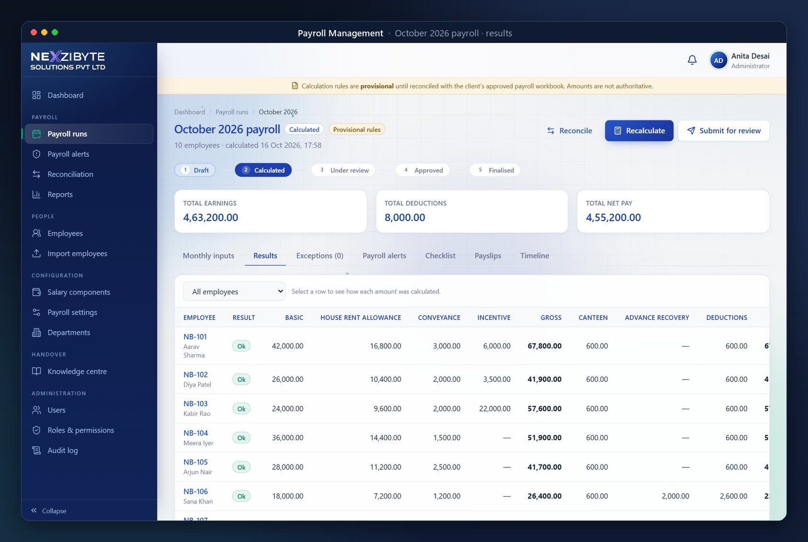<br><sub><b>Payroll run</b> — server-calculated results per employee and component</sub></td>
    <td width="50%">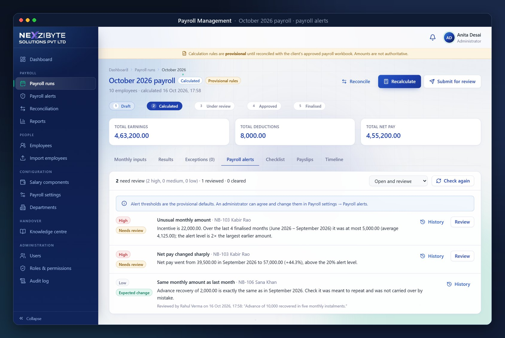<br><sub><b>Payroll alerts</b> — every alert explains the numbers and the threshold</sub></td>
  </tr>
  <tr>
    <td width="50%">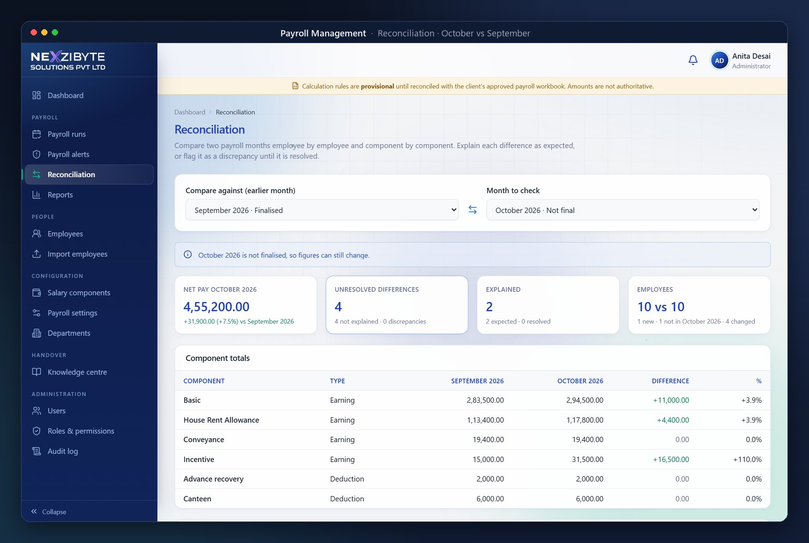<br><sub><b>Reconciliation</b> — month vs month, with expected vs unresolved differences</sub></td>
    <td width="50%">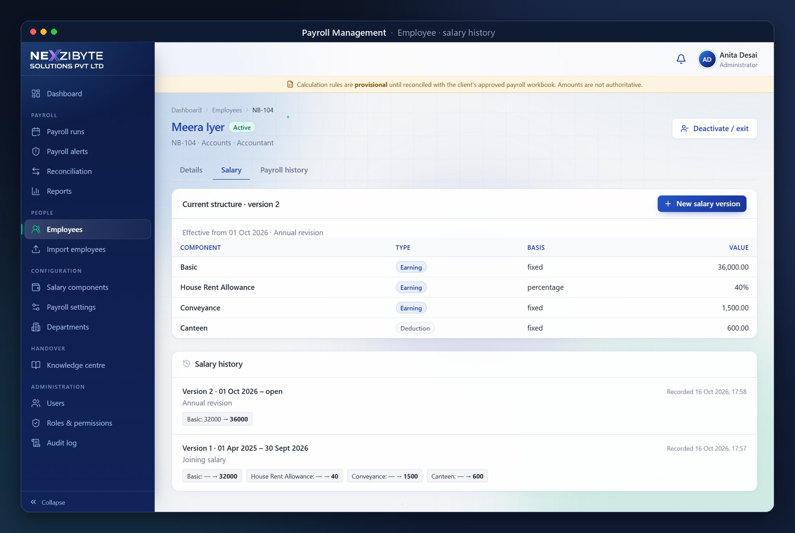<br><sub><b>Salary history</b> — versioned structures with effective dates</sub></td>
  </tr>
  <tr>
    <td width="50%">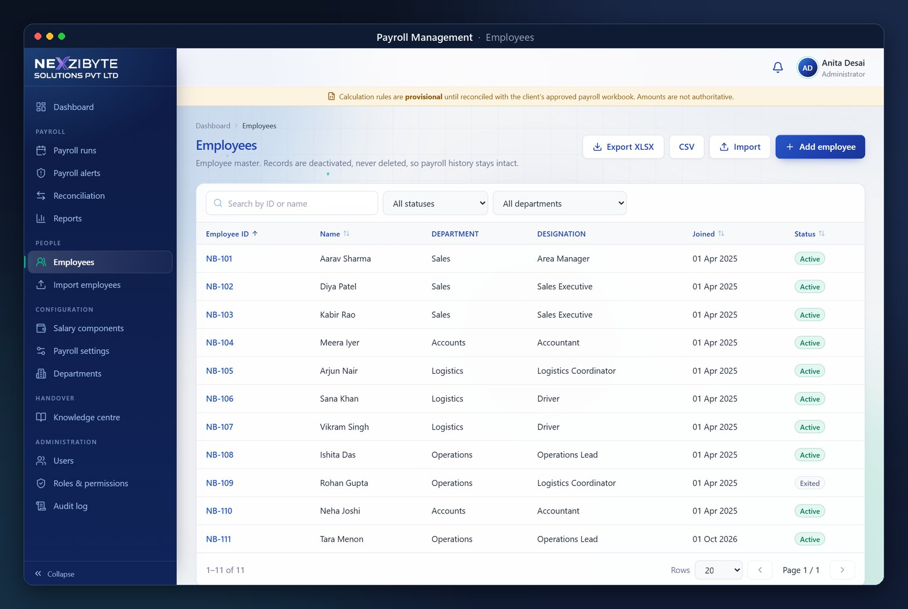<br><sub><b>Employees</b> — search, filters, import and export</sub></td>
    <td width="50%">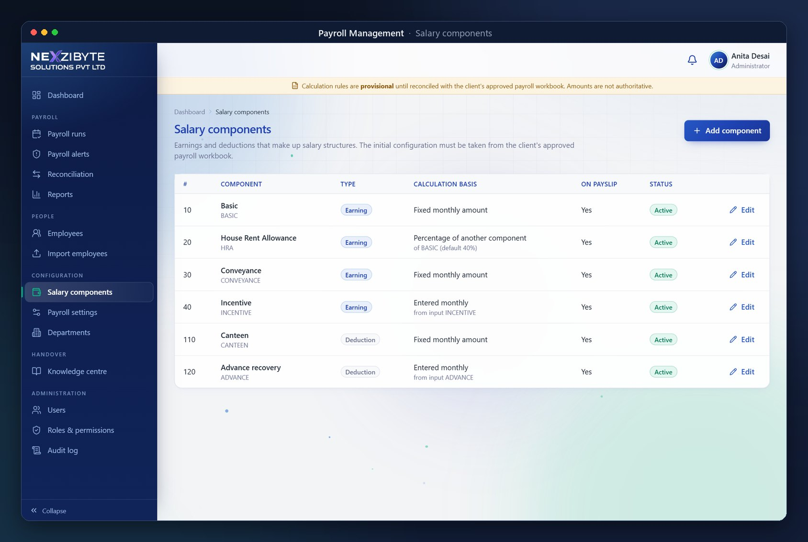<br><sub><b>Salary components</b> — fixed, percentage and monthly-input components</sub></td>
  </tr>
  <tr>
    <td width="50%">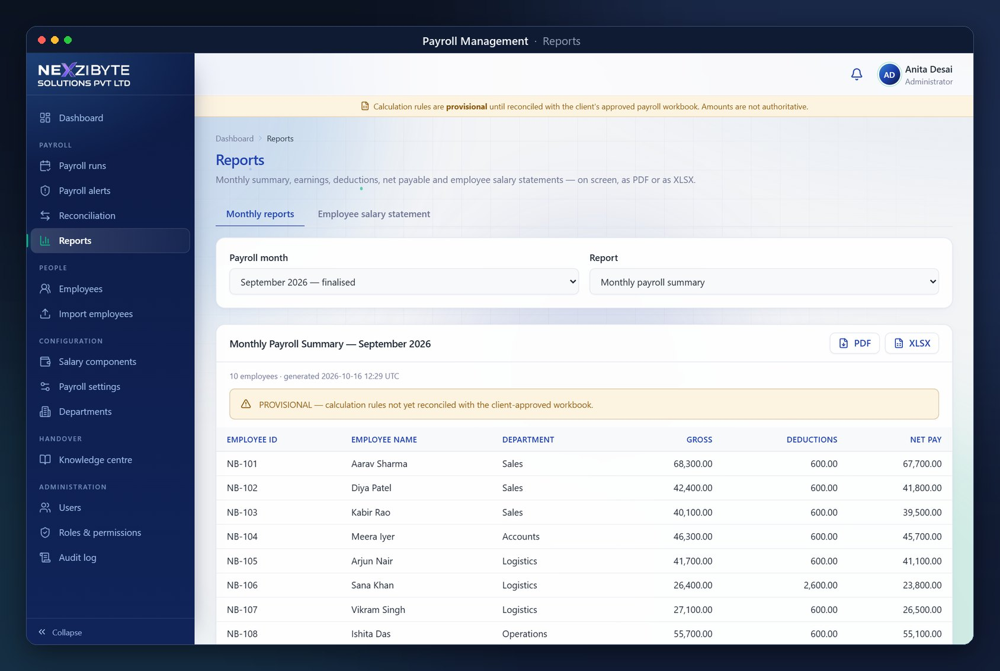<br><sub><b>Reports</b> — on screen, PDF or XLSX</sub></td>
    <td width="50%">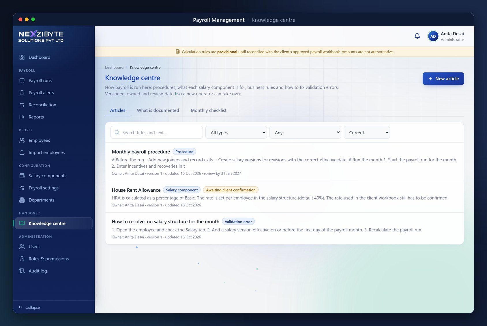<br><sub><b>Knowledge centre</b> — versioned, owned, review-dated</sub></td>
  </tr>
  <tr>
    <td colspan="2">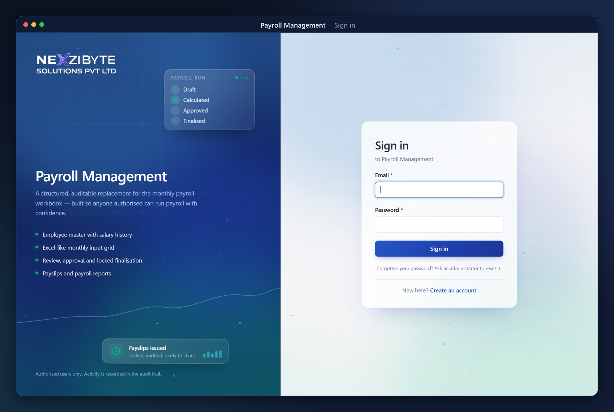<br><sub><b>Sign in</b> — lockout after repeated failures; optional email-verified sign-up</sub></td>
  </tr>
</table>


## ◆ System architecture

<p align="center">
  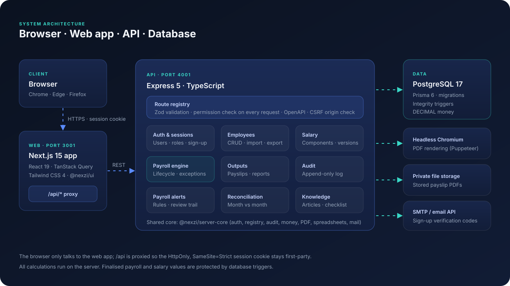
</p>

How a protected request travels through the system (for example, **Calculate**):

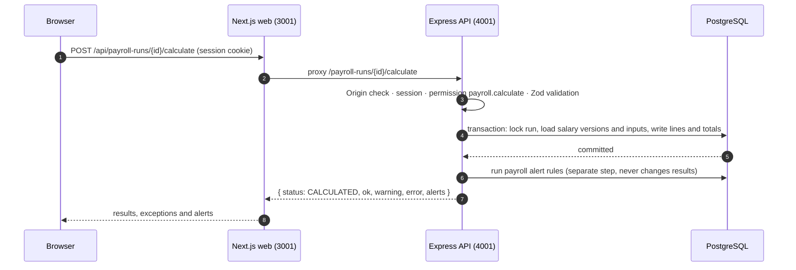

More detail: [docs/architecture.md](docs/architecture.md) · [docs/database-schema.md](docs/database-schema.md)


## ◆ Payroll workflow

<p align="center">
  
</p>

| Step | Who (default roles) | What the system enforces |
|---|---|---|
| Employees and salary | Administrator | Unique Employee ID; salary changes create a new version, old versions stay |
| Draft and inputs | Payroll User | One run per month; only active employees in the month; inputs validated per cell |
| Calculate | Payroll User | Server-side, deterministic; blocking exceptions (missing inputs, no salary structure, unconfigured formula) stop submission |
| Review | Payroll User | Warnings must be acknowledged; alerts reviewed; months reconciled |
| Approve and finalise | Administrator | Optional separate approver; finalised results locked by database triggers |
| Outputs | Payroll User | Payslips stored as PDFs with SHA-256; reports as PDF/XLSX |
| Re-open | Administrator only | Reason required, audit-logged; issued payslips are superseded |

Roles are permission sets: the client's final matrix is applied in **Roles & permissions**, not in code.


## ◆ Technology stack

| Layer | Technology | Why |
|---|---|---|
| Web | **Next.js 15.5**, React 19.1, TypeScript 5.9, Tailwind CSS 4, TanStack Query 5, React Hook Form | Table-heavy, keyboard-friendly screens; the browser only talks to its own origin |
| API | **Express 5**, Zod 4, Pino | One route registry declares validation and permissions and generates OpenAPI |
| Data | **PostgreSQL 17**, Prisma 6.19 | `DECIMAL` money, migrations, triggers that make history immutable |
| Documents | Puppeteer-core + Handlebars (PDF), ExcelJS and Papa Parse (XLSX/CSV) | Server-side payslips and reports; formula-injection-safe exports |
| Auth and mail | bcryptjs, server-side sessions, Nodemailer (SMTP) or Brevo/Resend HTTP APIs | Hashed passwords and session tokens; email-verified sign-up |
| Quality | Vitest, Supertest, Playwright, ESLint, esbuild | Unit, integration against real PostgreSQL, and browser end-to-end tests |


## ◆ Project structure

```text
Payroll-Management/
├── apps/
│   ├── payroll-api/            Express + Prisma API
│   │   ├── prisma/             schema.prisma, migrations, development seed
│   │   ├── src/
│   │   │   ├── modules/        employees, import, salary, masters, users
│   │   │   ├── payroll/        calculation engine, run lifecycle, routes
│   │   │   ├── output/         payslips, reports, PDF/XLSX templates
│   │   │   ├── anomalies/      payroll alert rules and review (change request A)
│   │   │   ├── reconciliation/ month-vs-month comparison (change request B)
│   │   │   ├── knowledge/      articles and monthly checklist (change request F)
│   │   │   └── analysis/       read-only loaders shared by A and B
│   │   └── test/               unit and integration tests
│   └── payroll-web/            Next.js app (App Router), public/brand logos
├── packages/
│   ├── server-core/            auth and sessions, route registry + OpenAPI, audit, money, PDF, spreadsheets, mail
│   └── ui/                     design tokens, components, app shell, sign-in/sign-up, motion effects
├── e2e/                        Playwright browser → API → PostgreSQL scenarios
├── infra/                      dev PostgreSQL launcher, API bundler, Dockerfiles, OpenAPI export
├── docs/                       architecture, schema, API, rules, security, testing, deployment, assets
└── docker-compose.yml          PostgreSQL (and optional app profile)
```


## ◆ Installation

**Prerequisites:** Node.js 20.11+ and npm 10+ · PostgreSQL 17 (Docker **or** the bundled embedded server — no Docker needed) · Chrome, Edge or Chromium for PDF rendering.

<details open>
<summary><b>Windows (PowerShell)</b></summary>

```powershell
npm install                                   # approve install scripts for prisma, esbuild, embedded-postgres if asked
Copy-Item apps\payroll-api\.env.example apps\payroll-api\.env
npm run db:start                              # keep this terminal open (or: docker compose up -d postgres)
# in a new terminal:
npm run prisma:generate
npm run db:migrate
npm run db:seed
npm run dev:api                               # terminal 1 — http://localhost:4001
npm run dev:web                               # terminal 2 — http://localhost:3001
```

</details>

<details>
<summary><b>macOS / Linux</b></summary>

```bash
npm install
cp apps/payroll-api/.env.example apps/payroll-api/.env
npm run db:start            # or: docker compose up -d postgres
npm run prisma:generate && npm run db:migrate && npm run db:seed
npm run dev:api             # terminal 1
npm run dev:web             # terminal 2
```

</details>

Open **http://localhost:3001** and sign in with the development accounts from the `SEED_*` values in your `.env`. The seed refuses to create them when `NODE_ENV=production`, and all seeded demo data is **synthetic** and labelled as such. API docs: **http://localhost:4001/docs**.

<details>
<summary><b>Key environment variables</b> (<code>apps/payroll-api/.env</code>)</summary>

| Variable | Purpose |
|---|---|
| `DATABASE_URL`, `TEST_DATABASE_URL` | Development and test databases (tests wipe the test database) |
| `ALLOWED_ORIGINS` | Browser origins allowed to make state-changing requests (CSRF check) |
| `COOKIE_SECURE`, `TRUST_PROXY` | Must be `true` / set behind HTTPS in production |
| `SESSION_IDLE_MINUTES`, `SESSION_ABSOLUTE_HOURS`, `LOGIN_MAX_FAILED_ATTEMPTS`, `LOGIN_LOCKOUT_MINUTES` | Session and lockout policy |
| `STORAGE_DIR`, `PDF_BROWSER_PATH` | Private payslip storage; optional browser path for PDFs |
| `PAYROLL_RULES_APPROVED`, `PAYSLIP_FORMAT_APPROVED` | Keep `false` until the client signs off (controls the PROVISIONAL labels) |
| `SIGNUP_ENABLED`, `SIGNUP_ALLOWED_DOMAINS`, `SIGNUP_REQUIRE_APPROVAL` | Self-service sign-up |
| `SMTP_HOST` … `MAIL_FROM`, or `MAIL_PROVIDER` + `MAIL_API_KEY` | Sign-up code email; leave `SMTP_HOST` empty in development to write emails to a local folder |

Secrets belong only in `.env` (git-ignored) or the host's secret store — never in the repository.

</details>

**Production first administrator:** `npm run build`, set `BOOTSTRAP_ADMIN_EMAIL`, `BOOTSTRAP_ADMIN_NAME` and `BOOTSTRAP_ADMIN_PASSWORD`, then run `npm run bootstrap:admin -w @nexzi/payroll-api` (the password must be changed at first sign-in). Deployment options (Docker Compose or Node processes): [docs/deployment.md](docs/deployment.md).


## ◆ Security and data integrity

| Control | Implementation |
|---|---|
| **Passwords** | bcrypt (cost 12); at least 10 characters with upper case, lower case and a digit; temporary passwords must be changed at first sign-in |
| **Sign-in** | Same error for unknown user and wrong password; lockout after 5 failures for 15 minutes; per-IP and global rate limits |
| **Sessions** | 256-bit random token in an `HttpOnly`, `SameSite=Strict` cookie (`Secure` + `__Host-` in production); only its SHA-256 is stored; idle and absolute expiry; revoked on logout, role or password change |
| **Authorisation** | Every endpoint declares its permission and is checked on the server; salary amounts need `payroll.view_amounts` |
| **CSRF and input** | Origin/Referer allow-list on every state-changing request; Zod validation; whitelisted sort fields; parameterised queries |
| **Documents** | PDFs rendered with JavaScript disabled and external requests blocked; stored privately with random keys; spreadsheet cells neutralised against formula injection |
| **Audit** | Append-only audit log (database trigger) for sign-ins, user/role, employee, salary and settings changes, the payroll lifecycle, imports and exports |
| **Integrity** | Database triggers make finalised payroll results, salary values, alert history and knowledge versions immutable |
| **Logging** | Structured JSON without request bodies, query strings, cookies or auth headers |

Full details: [docs/security.md](docs/security.md). No external security audit or certification has been performed.


## ◆ Roadmap

| Status | Item |
|---|---|
| ✅ Implemented | Employees, import/export, versioned salary, monthly payroll lifecycle, payslips, reports, RBAC, audit log, email-verified sign-up |
| ✅ Implemented *(awaiting change-request approval)* | Payroll alerts (A), reconciliation (B), knowledge centre (F) |
| ⏳ Blocked on client inputs | Client formulas and rounding from the workbook · reconciliation tests against real sample months · client-approved payslip and report layouts · agreed alert thresholds · final role matrix |
| 🗓️ Planned engineering | Build and smoke-test the Docker images · production deployment and backup schedule · approval screen for `SIGNUP_REQUIRE_APPROVAL` |
| 💡 Proposed, not approved | Scenario simulator (C) · employee document centre (D) · AI payroll assistant (E) · operations and recovery centre (G) — see [docs/feature-gap-analysis.md](docs/feature-gap-analysis.md) |
| 🚫 Out of scope | Statutory payroll (PF, ESI, TDS, professional tax) unless confirmed in writing · attendance capture · mobile apps |


## ◆ Testing

| Suite | Command | Last recorded result |
|---|---|---|
| Shared core unit tests | `npm run test -w @nexzi/server-core` | ✅ 8 / 8 (16 Oct 2026) |
| API unit + integration (real PostgreSQL) | `npm run test -w @nexzi/payroll-api` | ✅ 93 / 93 (16 Oct 2026) |
| Both of the above | `npm test` | |
| Browser end-to-end (Playwright) | `npm run test:e2e` | Payroll and sign-up scenarios exist; not re-run after the latest changes |
| Lint and types | `npm run lint` · `npm run typecheck` | ✅ clean (16 Oct 2026) |

Integration tests need PostgreSQL with the `payroll_test` database (`TEST_DATABASE_URL`) and wipe it on each run. Calculations are tested for mechanics only until the client's sample months arrive. What is covered: [docs/testing.md](docs/testing.md).


## ◆ Contributing

1. Create a branch from `main` (`feature/<topic>` or `fix/<topic>`).
2. Follow the existing patterns: declare every endpoint in the route registry with a Zod schema and a permission; money as decimal strings; schema changes only through a new Prisma migration (`npm run db:migrate:dev -w @nexzi/payroll-api -- --name <change>`); never edit applied migrations.
3. **Never invent payroll rules.** Formulas, components and wording come from the client workbook; open questions go to [docs/client-questions.md](docs/client-questions.md).
4. Add or update tests, then run `npm run lint`, `npm run typecheck` and `npm test` before opening a pull request.
5. Keep secrets and real employee data out of commits, issues and screenshots.


## ◆ Documentation

[Architecture](docs/architecture.md) · [Database schema](docs/database-schema.md) · [API reference](docs/api-reference.md) · [Business rules](docs/payroll-business-rules.md) · [Sign-up and email](docs/signup-and-email.md) · [Security](docs/security.md) · [Testing](docs/testing.md) · [Deployment](docs/deployment.md) · [Backup and restore](docs/backup-and-restore.md) · [Known gaps](docs/known-gaps.md) · [Client questions](docs/client-questions.md) · [Feature-gap analysis](docs/feature-gap-analysis.md) · [Change requests A, B, F](docs/change-requests.md)

## ◆ License and acknowledgments

This repository does not include a licence file. Unless NexziByte Solutions Pvt Ltd publishes one, all rights are reserved. Built on open-source software including Next.js, React, Express, Prisma, PostgreSQL, Tailwind CSS, TanStack Query, Zod, Puppeteer, ExcelJS, Lucide icons, Vitest and Playwright — thanks to their maintainers.

<p align="center">
  
</p>

<p align="center">
  <sub><a href="https://github.com/itinternsnexzibyte/Payroll-Management">github.com/itinternsnexzibyte/Payroll-Management</a> · <a href="#-about-the-project">Back to top ↑</a></sub>
</p>
