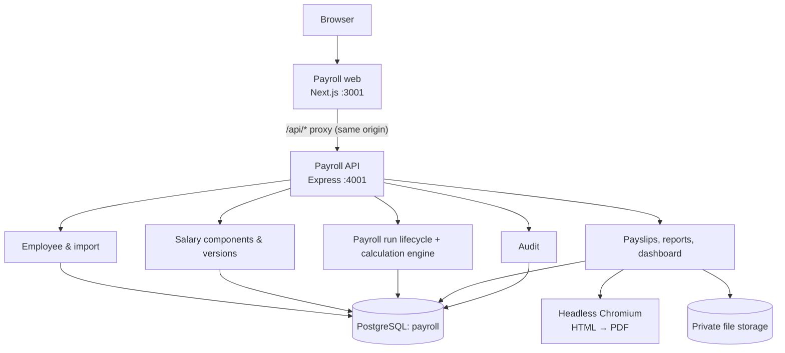
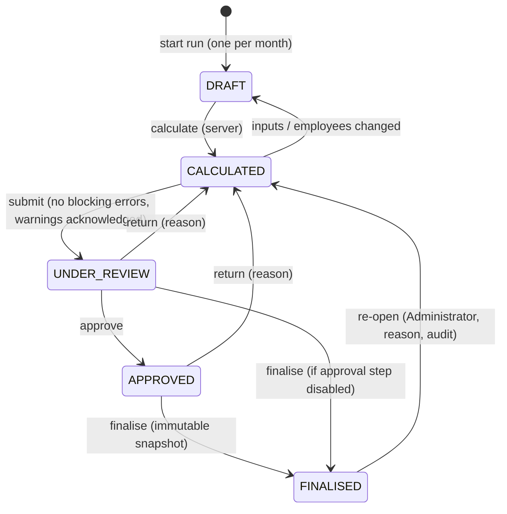

# Architecture

Four layers, as in the specification's architecture diagram: a responsive web frontend; a secure
API (authentication, RBAC, validation, payroll business rules); service modules; and a
centralised relational database. A document-output layer produces payslips and reports as PDFs.

## Key decisions

| Concern | Decision | Why |
|---|---|---|
| Backend | Express 5 + a route registry (`packages/server-core`) | One declaration per endpoint drives Zod validation, the permission check and the OpenAPI docs, so docs and enforcement cannot drift |
| Auth | Server-side sessions (random 256-bit token, SHA-256 stored) in an `HttpOnly`, `SameSite=Strict` cookie, with idle and absolute timeouts | Immediate revocation on logout / disable / password change; no token reachable from JavaScript |
| Same-origin API | Next.js rewrites `/api/*` to the API | First-party cookie; no browser CORS |
| CSRF | SameSite=Strict + Origin/Referer allow-list on state-changing requests | Defence in depth |
| Database | Prisma 6 on PostgreSQL 17 | Migrations, typed queries, `DECIMAL` money |
| Money | `DECIMAL` columns, `decimal.js`, decimal strings in JSON | No floating point in calculations |
| Integrity | DB triggers in addition to API checks | Append-only audit log; finalised payroll rows and salary values cannot be changed even by direct SQL |
| Calculation | Pure, deterministic engine (`apps/payroll-api/src/payroll/engine.ts`) | Unit-testable; a hash of all inputs detects stale results before approval/finalisation |
| PDFs | Handlebars HTML → headless Chromium (`puppeteer-core`) with JavaScript disabled and network blocked | Faithful reproduction of the client's format once supplied |
| Files | Private `STORAGE_DIR`, random UUID keys, served only by authorised endpoints | No public or guessable URLs |
| Monorepo | npm workspaces; shared TS packages resolved by path aliases and bundled into the API with esbuild | Works without symlinks; produces a single `dist/server.js` |
| Frontend | Next.js 15, TanStack Query, React Hook Form + Zod, Tailwind v4 tokens, Recharts, Lucide | Shared design system in `packages/ui`; all data comes from the API |

## Payroll run state machine

Calculation, submission, approval, finalisation and re-opening each run in a database
transaction with a row lock on the run, so concurrent duplicate actions cannot both succeed.
