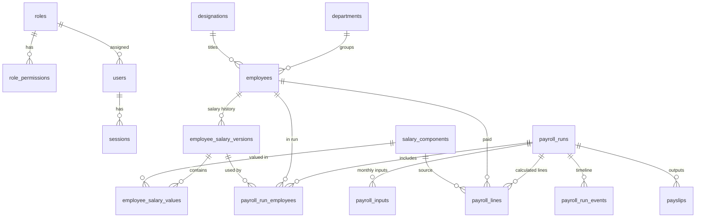

# Database schema

Authoritative definition: `apps/payroll-api/prisma/schema.prisma`; SQL in
`apps/payroll-api/prisma/migrations/`. Money is `DECIMAL`; business tables carry
`createdAt/updatedAt` and `createdById/updatedById` where relevant.

| Table | Purpose / notable constraints |
|---|---|
| `users`, `roles`, `role_permissions`, `sessions` | Accounts, permission sets, server-side sessions (unique token hash). Case-insensitive unique email |
| `audit_logs` | Append-only (trigger blocks UPDATE/DELETE); indexed by time, entity, actor, action |
| `departments`, `designations` | Masters (unique names, soft-deactivated) |
| `employees` | Unique business `employeeCode` (also case-insensitive). Never hard-deleted |
| `salary_components` | Unique code; type EARNING/DEDUCTION; basis FIXED / PERCENTAGE / INPUT / FORMULA; order; payslip visibility |
| `employee_salary_versions` / `employee_salary_values` | Versioned structures: unique (employee, versionNo) and (employee, effectiveFrom); values immutable (trigger) |
| `payroll_input_definitions` | Columns of the monthly input grid |
| `payroll_settings` | Rounding rule, version-selection rule, approval policy, warning threshold |
| `payroll_runs` | Unique (year, month). Status, totals, calculation hash, approval timestamps, reopen count |
| `payroll_run_employees` | Per-employee identity snapshot, gross/deductions/net, exceptions. Locked when the run is FINALISED (trigger) |
| `payroll_inputs` | Monthly key/value inputs, unique (run, employee, key). Locked when FINALISED |
| `payroll_lines` | One line per component per employee with name/type/basis snapshot. Locked when FINALISED |
| `payroll_run_events` | Timeline with actor and reason |
| `payslips` | Stored PDF reference (random key + SHA-256); superseded on re-open |
| `import_jobs` | Import previews, mapping, results and failed rows |
| `payroll_anomalies` / `payroll_anomaly_events` | Payroll alerts per run: unique (run, fingerprint), severity, status, review; event trail is append-only (trigger) |
| `reconciliation_notes` | Explanations between two runs: unique (base run, compare run, employee, component); runs must differ (check) |
| `knowledge_articles` / `knowledge_article_versions` | Knowledge centre: current article plus immutable versions, unique (article, version) (trigger blocks UPDATE/DELETE) |
| `payroll_checklist_items` / `payroll_run_checklist` | Monthly checklist template and per-run progress, unique (run, step) |

| Migration | Content |
|---|---|
| `20261015162158_init` | Tables, enums, foreign keys (RESTRICT to protect history), indexes |
| `20261016104813_anomalies_reconciliation_knowledge` | Change requests A, B, F: alert, reconciliation, knowledge and checklist tables, append-only triggers, distinct-runs check |
| `20261015170000_integrity_triggers` | Append-only audit, finalised-run guards, immutable salary values, case-insensitive unique indexes |
